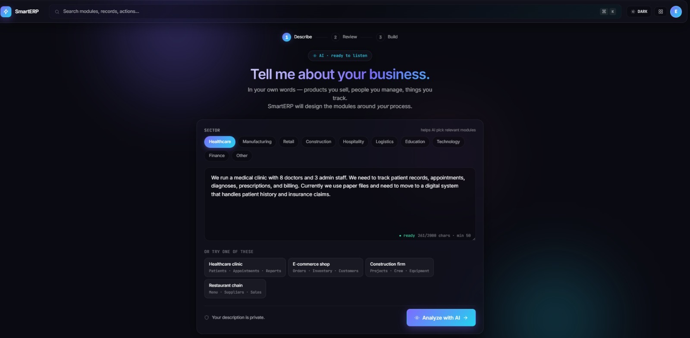
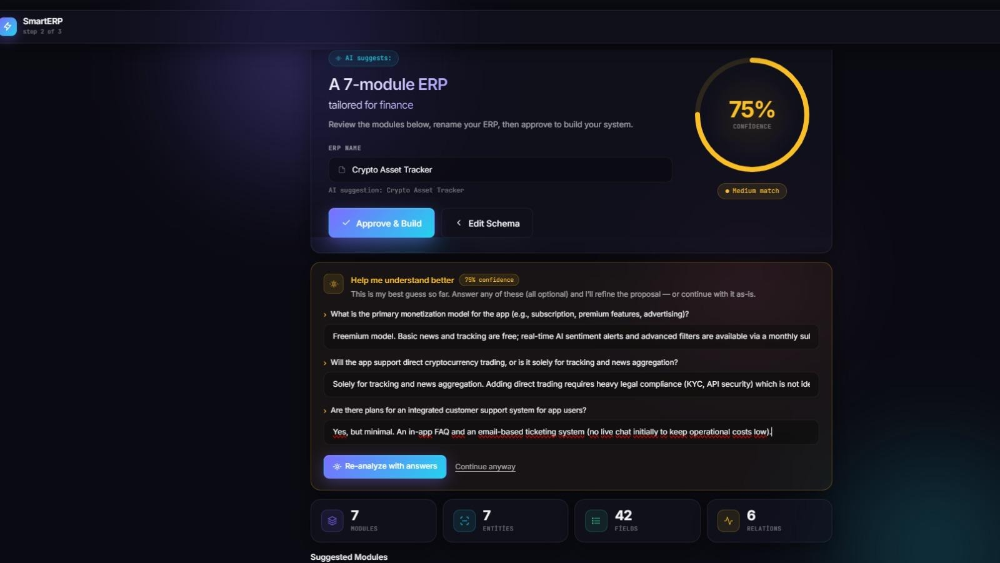
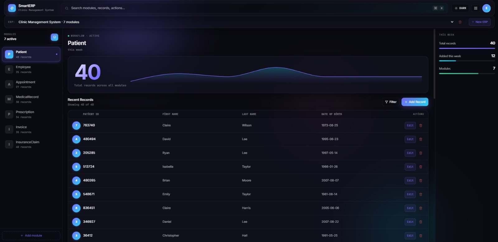
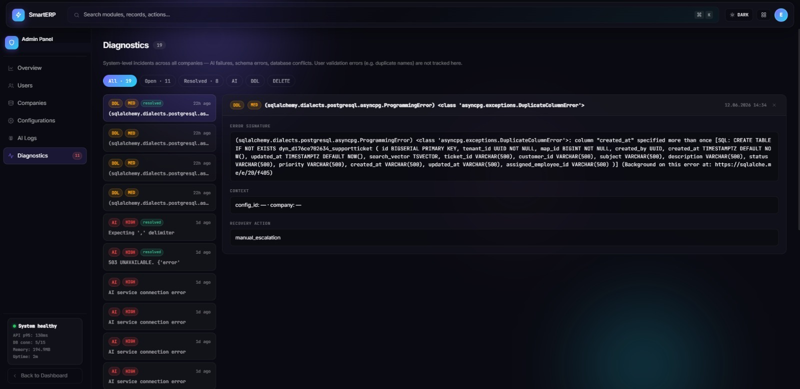
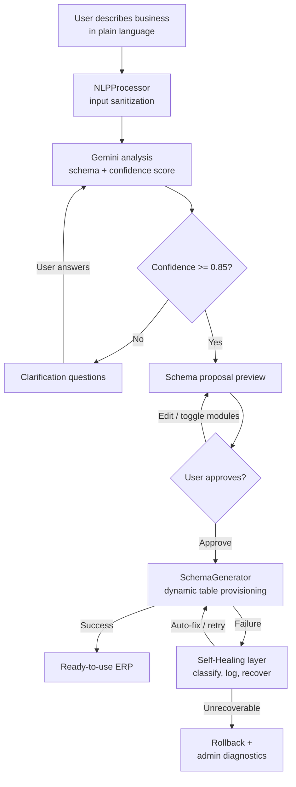

# SmartERP Builder

> Describe your business in plain language and get a working, multi-tenant ERP in minutes.

[](https://github.com/EmirhanV0/SmartERP-Builder/actions/workflows/ci.yml)


## What is it?

Off-the-shelf ERP systems are expensive, rigid, and usually need consultants to set up, which puts them out of reach for most small and medium-sized enterprises (SMEs). SmartERP Builder removes that barrier: the user describes how their business works in natural language, Google Gemini turns the description into a custom ERP schema (modules, entities and fields), and after the user approves it the platform provisions the database tables at runtime. The result is a ready-to-use ERP with full CRUD, dashboards, an admin panel and a self-healing diagnostics layer. No code or ERP expertise is required. It is built for SME owners and operators who need structured business software without a long, costly implementation project.

## Screenshots

| | |
|---|---|
|  |  |
| **Describe your business in plain language** | **AI proposal with confidence score and clarification questions** |
|  |  |
| **Generated ERP dashboard with live records** | **Admin diagnostics: Self-Healing incident log** |

## How it works

1. **Describe:** the user writes a plain-language description of their business and picks a sector.
2. **Analyze:** the input is sanitized and sent to Gemini, which returns entities, fields, relationships, recommended modules and a **confidence score**.
3. **Clarify:** if confidence is below **0.85**, the user answers a few clarification questions and the analysis runs again with the extra context.
4. **Approve:** the user reviews the proposal, toggles modules or entities if needed, and approves it.
5. **Provision:** the schema generator creates the dynamic tables inside a single transaction. Failures go to the Self-Healing layer.
6. **Use:** the ERP is ready right away, with CRUD forms, record tables and dashboards.



## Key features

- **Multi-tenant isolation:** every tenant's configurations, modules and records are scoped by `tenant_id`, and dynamic tables are provisioned per tenant.
- **Confidence score and clarification loop:** Gemini reports how sure it is about the proposed schema. Below the 0.85 threshold, the system asks targeted clarification questions before it builds anything.
- **Self-Healing layer:** provisioning and AI failures are treated as recoverable events, not crashes.
  - `SelfHealingEngine` coordinates recovery and never raises into the main request flow.
  - `AutomatedRecoveryManager` classifies failures (SQLSTATE, then HTTP status, then JSON parse error, then stage) and picks an action: `auto_fix_identifier`, `retry_fallback_prompt`, `rollback` or `manual_escalation`.
  - `DiagnosticLogger` writes every incident to `DIAGNOSTIC_LOG` defensively.
  - Transient Gemini errors are **retried with exponential backoff**. Incidents that recover on their own are recorded as **auto-resolved**.
- **Reserved-column auto-fix:** AI-generated field names that collide with system columns (`id`, `tenant_id`, `created_at`, ...) or with each other are renamed automatically, so `CREATE TABLE` never fails on a duplicate column.
- **Smart form fields:** input components adapt to the detected field type (phone, currency, enum dropdown, gender selector, date, email and more).
- **Admin panel:** live system health (uptime, p95 latency, DB pool, memory), analytics (sector distribution, top tenants, AI confidence histogram) and a diagnostics view for Self-Healing incidents.
- **Mobile responsive:** the React + TailwindCSS UI works on desktop, tablet and phone.
- **Extras:** manual module addition, soft deletes, full-text search (TSVECTOR), multiple ERP configurations per tenant, and a `Ctrl+K` command palette.

## Architecture

SmartERP Builder has four layers:

1. **Presentation:** React SPA (Describe, Preview, Dashboard, Admin, Profile)
2. **Controller:** FastAPI routers (Auth, Users, Configurations, Schema, Prompt, Dynamic Data, Admin)
3. **Service:** NLPProcessor, SchemaGenerator, Self-Healing services, BenchmarkEngine, APIGenerator, AuthService
4. **Persistence:** PostgreSQL with 8 static tables (SQLAlchemy + Alembic) and dynamic tables created at runtime (raw SQL, JSONB, GIN indexes)

See **[ARCHITECTURE.md](ARCHITECTURE.md)** for the database schema, AI pipeline, Self-Healing internals and the full API reference.

## Tech stack

| Layer | Technology |
|---|---|
| Backend | FastAPI (Python 3.11+, fully async), Pydantic |
| Database | PostgreSQL 15 (JSONB, GIN indexes, TSVECTOR full-text search) |
| Persistence | SQLAlchemy async + asyncpg, Alembic migrations, raw SQL for dynamic tables |
| Authentication | JWT (python-jose), bcrypt (passlib) |
| AI | Google Gemini 2.5 Flash |
| Frontend | React 18, Vite, TailwindCSS, Recharts |
| Infrastructure | Docker, Docker Compose |

## Prerequisites
- Docker Desktop (includes Docker Compose)
- A Google Gemini API key — free tier at https://aistudio.google.com/apikey

## Setup

1. **Create your environment file**
   Copy `.env.example` to `.env`:

   ```
   copy .env.example .env        # Windows
   cp .env.example .env          # macOS/Linux
   ```

2. **Edit `.env` and set:**
   - `GEMINI_API_KEY` — your Google Gemini API key (from https://aistudio.google.com)
   - `ADMIN_EMAILS` — the email you will register as admin (e.g. your-email@example.com)
   - `SECRET_KEY` — a random secret, generate with:

     ```
     python -c "import secrets; print(secrets.token_hex(32))"
     ```
   - You may keep the default PostgreSQL credentials for local use.

3. **Build and start**

   ```
   docker-compose up --build
   ```

   Database migrations run automatically on backend startup.

4. **Access**
   - Frontend: http://localhost:3000
   - Backend API: http://localhost:8000
   - API docs (Swagger): http://localhost:8000/docs

## First Use

1. Open http://localhost:3000 and click **Register**
2. Register using the email you set in `ADMIN_EMAILS` — this account gets admin access. Any other email registers as a regular user.
3. Log in and describe your business in natural language to generate your first ERP.

## Optional: Seed Demo Data

Populate the system with realistic sample records:

```
docker-compose exec backend python scripts/seed_demo_records.py --fresh
```

Generate sample diagnostic incidents (visible in the admin Diagnostics panel):

```
docker-compose exec backend python scripts/gen_incidents.py
```

## Notes
- Gemini free tier allows 20 requests/day. Enable billing on your Google AI Studio project for heavier use.
- No API key? Set `GEMINI_MOCK=true` in `.env` to run with mock AI responses.

## Project Structure

```
backend/    FastAPI application (controllers, services, models, migrations)
frontend/   React application (pages, components, design system)
docs/       Screenshots and documentation assets
docker-compose.yml
.env.example
```

## Roadmap

- [ ] **Internationalization (i18n):** multi-language UI and AI prompts
- [ ] **Redis cache:** cache schema lookups and analytics queries
- [ ] **Native mobile apps:** iOS and Android clients on the existing API
- [ ] **Industry templates:** pre-built starting schemas for common sectors
- [ ] **Integrations:** outbound webhooks and REST connectors to third-party systems
- [ ] **Granular RBAC:** per-module and per-field permissions beyond the admin/user roles

## License

No license has been granted. All rights reserved by the authors. The source is published for viewing and portfolio purposes.

## Authors

- **Vehbi Emirhan Yeşildağ**
- **Mert Gürgen**
- **Engincan Sadık Kalaycı**

Graduation project — Halic University, Computer Engineering.
